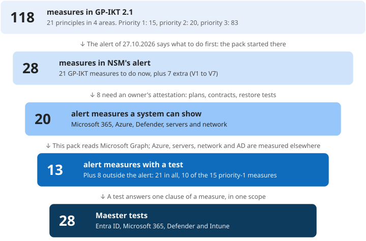

# Maester Pack: NSM GP-IKT 2.1 (NSMs grunnprinsipper for IKT-sikkerhet)

A [Maester](https://maester.dev) Pack that measures NSM's basic principles for ICT security (GP-IKT 2.1) and the
measures in NSM's alert of 27.10.2026 in Microsoft 365, Entra ID and Intune.

**An add-on to Maester.** Maester already tests a tenant against CIS, CISA and Microsoft's recommendations. This pack
adds the NSM view next to them: how far the tenant meets NSM's measures, on NSM's own scale, measure by measure. It
is meant to support organisations running an NSM programme: to see where they stand, agree what to fix first, and
follow progress from run to run. How it works: [docs/README.md](docs/README.md).

**A free community pack.** Free to use and change under the MIT licence, and open to contributions from anyone. It is not a product of NSM, the Maester project, Microsoft or any company, is not made or endorsed
by NSM, and comes with no support agreement or warranty.

- **Using the pack (Norwegian):** [nsm-gp-ikt/README.md](nsm-gp-ikt/README.md)
- **How it works (start here):** [docs/README.md](docs/README.md)
- **Tests:** [docs/tests.md](docs/tests.md) · **Coverage of NSM's 118 measures:** [docs/coverage.md](docs/coverage.md)
- **How tests map to NSM:** [docs/mapping.md](docs/mapping.md) · **Permissions:** [docs/permissions.md](docs/permissions.md)
- **What the pack adds to Maester, and Maester 3 versus 2:** [docs/maester-comparison.md](docs/maester-comparison.md)
- **Verifying the pack:** [docs/verification.md](docs/verification.md) · **Changes:** [CHANGELOG.md](CHANGELOG.md)
- **Language:** Norwegian for everything a user sees in a run, English for how the pack is built: [docs/language.md](docs/language.md)

## Install

```powershell
Install-Module Maester -AllowPrerelease -Scope CurrentUser      # Maester 3.0
Install-MtPack alventech/maester-pack-nsm-gp-ikt/nsm-gp-ikt
Invoke-Maester -Pack NSM
```

On Maester 2.x, unpack `nsm-gp-ikt-maester2-<version>.zip` from the latest
[release](https://github.com/alventech/maester-pack-nsm-gp-ikt/releases) into `tests/Custom/`. The permissions and
settings are in the [pack's README](nsm-gp-ikt/README.md) and [docs/permissions.md](docs/permissions.md).

## What the tests cover

NSM's principles span clients, servers, networks, OT and processes. The pack measures the part Microsoft Graph can
read: 21 measures, with 28 tests. A test answers one clause of a measure within one scope, so a measure with a test
is not a measure that is covered; [docs/coverage.md](docs/coverage.md) shows the clause and scope of each.




## Where the pack fits: the control map

The tests come from a map of NSM's measures to Microsoft controls, per platform. Here is the identity part: four
measures, five controls, and the platforms each control covers.


And the whole map for the measures in NSM's alert, grouped by principle, with how each is measured:


The map is broader than the tests: it says which control implements a measure, while a test specifies only the clause
its reading proves. Windows LAPS, for example, supports 2.6.4 in the map, but test 3001 specifies 2.3.7 (no shared
default passwords); [docs/mapping.md](docs/mapping.md) has the rules.

This pack measures the Microsoft Graph part. The Azure part is measured by a separate Azure Policy initiative that
groups Microsoft's built-in policies by NSM measure. It will be published as its own free community repository;
the link is added here when it is public. What is left, such as network, OT and processes, needs an owner's
attestation.

## Repository

```
nsm-gp-ikt/                    the pack: install with Install-MtPack alventech/maester-pack-nsm-gp-ikt/nsm-gp-ikt
  maester-pack.json
  helpers/NsmHelpers.ps1
  tests/                       Test.MP.NSM.<n>.ps1 and .md, suite.json
    frameworks/                generated: nsm-gp-ikt.json, nsm-varsel-2026.json
tools/
  extract_gp.py                NSM's spreadsheet -> data/gp-ikt-2.1.json
  export_frameworks.py         data -> framework files and the NSM links in each test's .md
  generate_docs.py             tests -> docs/tests.md, docs/coverage.md, the table in the pack's README
  build_maester2.py            the pack -> dist/NSM and the Maester 2 zip (custom tests), built per release
  nsm_links.py                 links to measures on nsm.no
  data/                        gp-ikt-2.1.json, nsm-alert-2026.json
maester2/                      Maester 2.x support: NsmMaester2.ps1 (shim) and the README shipped in the zip
scripts/
  Invoke-NsmPackSmokeTest.ps1  runs the pack from source against a tenant and checks every result
unit-tests/
  NsmPack.Tests.ps1            Pester tests with mocked Graph responses
unit-tests-maester2/           the Maester 2 build and shim; run in a process with Maester 2.3.0
docs/
  images/                      diagrams for this README
```

## Develop

```powershell
Install-Module Maester -AllowPrerelease -Scope CurrentUser
Connect-MgGraph -Scopes ((Get-MtGraphScope) + 'AttackSimulation.Read.All', 'RoleManagementPolicy.Read.Directory', 'SecurityEvents.Read.All')

Invoke-MtTest -Path ./nsm-gp-ikt                     # every test, from source
Invoke-MtTest -Path ./nsm-gp-ikt -Id MP.NSM.1006     # one test
Invoke-Pester ./unit-tests                           # unit tests, no tenant needed
Test-MtPack ./nsm-gp-ikt                             # what Install-MtPack and the index check
./scripts/Invoke-NsmPackSmokeTest.ps1 -SkipConnect   # run and check every result
```

After changing a test's `Control`, `Title` or levels, or NSM's data, regenerate (Python 3.9+, standard library):

```bash
python3 tools/export_frameworks.py
python3 tools/generate_docs.py
```

For Maester 2.x, build the custom tests and test them in a separate process with Maester 2.3.0:

```bash
python3 tools/build_maester2.py                      # dist/NSM and dist/nsm-gp-ikt-maester2-<version>.zip
pwsh -c "Import-Module Maester -RequiredVersion 2.3.0; Invoke-Pester ./unit-tests-maester2"
```

CI fails when the generated files are out of date. See [CONTRIBUTING.md](CONTRIBUTING.md).

## Where your data goes

The pack reads Microsoft Graph and sends nothing anywhere: it has no network access of its own (`Uses.Network` is
empty) and writes nothing to the tenant. Maester writes the report where you run it, and the report names your
policies, roles, accounts and devices, so store it as internal. Maester itself counts installs and runs: when you install a
public pack it sends the pack's source and commit with a random installation ID. It sends nothing for a private
repository or a local folder, and `MAESTER_DISABLE_TELEMETRY=1` (or `Invoke-Maester -DisableTelemetry`) turns it
off. See [docs/permissions.md](docs/permissions.md) for the permissions and
how to protect the identity that runs the pack.

## Contributing and support

Contributions are welcome: new tests, fixes, and reports from tenants the pack has not been run in. People will
sometimes disagree with a level; open a "Wrong verdict" issue with the test ID, the kind of tenant (licences,
cloud-only or hybrid; never its name, domain or IDs) and what the portal shows, and the rule is discussed in the open. See [CONTRIBUTING.md](CONTRIBUTING.md). The pack is maintained
voluntarily by alventech, with no promised response time, and co-maintainers are welcome: open an issue if you
would like to help. Report security problems as [SECURITY.md](SECURITY.md) describes.

## Licence

[MIT](LICENSE), copyright alventech. NSM's principles are NSM's; this repository links to them on nsm.no and does not copy them.
