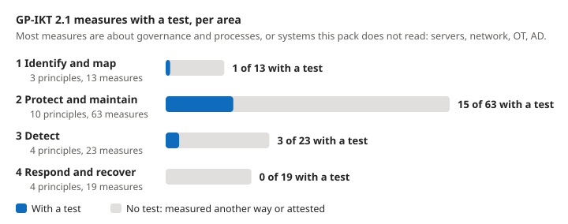

# How the pack works

The pack is an add-on to [Maester](https://maester.dev). Maester already tests a Microsoft 365 tenant against CIS,
CISA and Microsoft's own recommendations; this pack adds the view an organisation working with NSM needs: how far
the tenant meets the measures in *NSM's ICT Security Principles* (GP-IKT 2.1) and NSM's alert of 27 October 2026,
on NSM's own scale, measure by measure. Use it next to Maester's tests, as support for an NSM programme: to see
where you stand, agree what to fix first, and follow progress from run to run.

## Solution design

![How the pack works: 1. the pack reads the tenant through Microsoft Graph, read only, with 12 read permissions (Entra ID, Microsoft 365, Intune, Defender); 2. Maester runs its 28 tests next to Maester's own, as a pack on Maester 3 or as custom tests from the release zip on Maester 2; 3. each result is on NSM's scale, høy grad (passed), moderat or liten grad, with its scope on the second line, and a missing licence or permission skips the test with a reason; 4. the Maester report shows every result and a frameworks view per NSM measure, linked to nsm.no. One mapping catalogue, tools/data/mapping.json, gives each test its measure, clause, link strength and scope](images/solution-design.svg)

1. **Read only.** Every request is a GET to Microsoft Graph. The pack never changes the tenant, but its permissions
   read the whole security configuration, so the identity that runs it needs care: [permissions](permissions.md).
2. **Maester runs the tests.** On Maester 3 the pack is installed with `Install-MtPack`; on Maester 2, which has no
   packs, the same tests come as custom tests in a zip on each release ([comparison](maester-comparison.md)).
3. **NSM's scale.** Each result starts with *høy*, *moderat* or *liten grad*, and names the scope it holds for. Only
   *høy grad* passes, so the report shows what is left. A test that cannot measure skips with a reason instead of
   guessing.
4. **The report.** Maester's report shows each result, and its frameworks view groups them by NSM measure.

Behind every test is one catalogue, [`tools/data/mapping.json`](../tools/data/mapping.json): which measure and
clause the test specifies, how strong the link is, and its scope. The framework files and most of these documents
are generated from it, so they cannot drift from the tests.

## What it covers, and what it does not

*NSM's ICT Security Principles* (GP-IKT) 2.1 has **118 measures**, grouped in **21 principles** and four areas:
identify and map, protect and maintain, detect, and respond and recover. NSM gives each measure a priority: 15 are
priority 1, 20 priority 2 and 83 priority 3. NSM's alert of 27 October 2026 picked 21 of the measures to do now and
added seven of its own (V1 to V7), 28 in all.

Most measures are about governance and processes, or about systems that Microsoft Graph does not show: servers,
network equipment, operational technology (OT) and on-premises Active Directory. The pack started from the alert and
measures what Microsoft Graph can read.
That gives 28 tests for 21 measures, among them 10 of the 15 priority-1 measures:

![Why the pack has 28 tests: 118 measures in GP-IKT 2.1 (21 principles in 4 areas; priority 1: 15, priority 2: 20, priority 3: 83). NSM's alert says what to do first: 28 measures, 21 from GP-IKT plus 7 extra (V1 to V7). 8 of them need an owner's attestation (plans, contracts, restore tests), leaving 20 that a system can show (Microsoft 365, Azure, Defender, servers and network). The pack reads Microsoft Graph only, so 13 of the alert's measures have a test, plus 8 measures outside the alert: 21 in all, 10 of the 15 priority-1 measures. A test answers one clause of a measure in one scope, so there are 28 tests](images/why-28-tests.svg)

A measure without a test is not ignored: Azure is measured by an Azure Policy initiative, servers, network and OT by
other tools, and plans, contracts and restore tests are attested by their owner. On-premises Active
Directory is different: Maester can already read it, through its own
[Active Directory connection](https://maester.dev/docs/connect-maester/ad-connection-troubleshooting)
(`Connect-Maester -Service ActiveDirectory`) and its built-in AD tests. This pack does not use that connection. The
NSM measures that depend on AD are planned as a **second pack in this repository** (`nsm-gp-ikt-ad/`), built on
Maester's own AD tests, so organisations without on-premises AD never need it. It needs more time than the Graph
pack: the measures must be mapped and verified against a real domain first. [coverage.md](coverage.md) lists every measure and the tests that specify it.

## The documents

| Document | Read it to |
| --- | --- |
| [tests.md](tests.md) | See every test: its NSM measures, scope, levels, licence and permissions (generated) |
| [coverage.md](coverage.md) | See every NSM measure, and which tests specify it and how strongly (generated) |
| [mapping.md](mapping.md) | Understand how a test is linked to a measure: clause, strength and scope, and the rules |
| [permissions.md](permissions.md) | Grant the Graph permissions, and secure and monitor the identity that runs the pack |
| [maester-comparison.md](maester-comparison.md) | See how the pack differs from Maester's own tests, and Maester 3 from Maester 2 |
| [verification.md](verification.md) | Run the smoke test, check verdicts against the portals, and see what has been verified |
| [language.md](language.md) | Know why the report text is Norwegian and the documents English |
